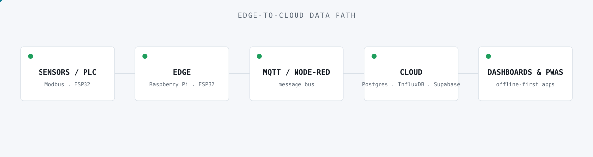
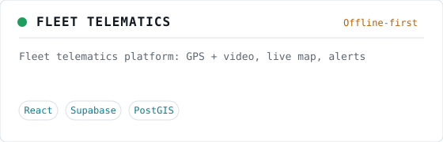
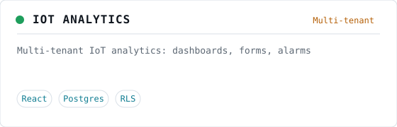
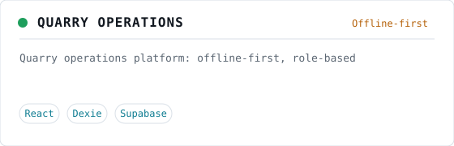
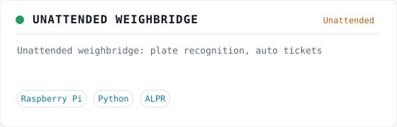
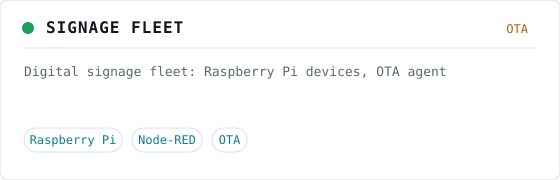
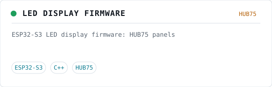
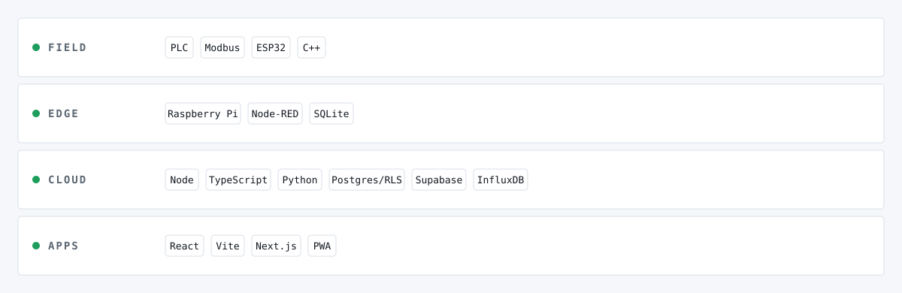

<picture>
  <source media="(prefers-color-scheme: dark)" srcset="assets/header-dark.svg">
  
</picture>

<b>I build the whole stack: the sensor on site, the device at the edge, and the platform in the cloud.</b>

  <picture>
    <source media="(prefers-color-scheme: dark)" srcset="assets/typing-dark.svg">
    
  </picture>

<picture>
  <source media="(prefers-color-scheme: dark)" srcset="assets/architecture-dark.svg">
  
</picture>

## ▍Deployed systems

<a href="case-studies/fleet-telematics.md"><picture><source media="(prefers-color-scheme: dark)" srcset="assets/cards/fleet-telematics-dark.svg"></picture></a>
<a href="case-studies/iot-analytics.md"><picture><source media="(prefers-color-scheme: dark)" srcset="assets/cards/iot-analytics-dark.svg"></picture></a>

<a href="case-studies/quarry-operations.md"><picture><source media="(prefers-color-scheme: dark)" srcset="assets/cards/quarry-operations-dark.svg"></picture></a>
<a href="case-studies/unattended-weighbridge.md"><picture><source media="(prefers-color-scheme: dark)" srcset="assets/cards/unattended-weighbridge-dark.svg"></picture></a>

<a href="case-studies/signage-fleet.md"><picture><source media="(prefers-color-scheme: dark)" srcset="assets/cards/signage-fleet-dark.svg"></picture></a>
<a href="case-studies/led-display-firmware.md"><picture><source media="(prefers-color-scheme: dark)" srcset="assets/cards/led-display-firmware-dark.svg"></picture></a>

## ▍Equipment rack

<picture>
  <source media="(prefers-color-scheme: dark)" srcset="assets/stack-dark.svg">
  
</picture>

## ▍Telemetry

<picture>
  <source media="(prefers-color-scheme: dark)" srcset="https://raw.githubusercontent.com/EnZo1826/EnZo1826/output/github-snake-dark.svg">
  
</picture>

<!--
metrics.svg is generated at repo root by a scheduled GitHub Action (Forge's issue).
The snake above is generated on branch `output` by a scheduled GitHub Action (Forge's issue);
paths may be adjusted there if the action lays files out differently.
-->

  Open to projects in Southern Africa and remote ·
  <a href="https://www.linkedin.com/in/YOUR-HANDLE">LinkedIn</a> ·
  <a href="mailto:you@example.com">Email</a>

<!-- TODO(Jakes): fill LinkedIn + email -->
