<picture>
  <source media="(prefers-color-scheme: dark)" srcset="assets/hero-dark.svg">
  
</picture>

  <picture>
    <source media="(prefers-color-scheme: dark)" srcset="assets/terminal-dark.svg">
    
  </picture>

I work across the boundary between operational technology and information technology: field sensors, industrial PLCs and edge computers on one side; APIs, databases, dashboards, business systems and AI tooling on the other.

Most of what I build is a complete chain rather than an isolated component. A pulse from a meter, an input on a PLC or a GPS fix becomes a record, an alarm, a report or a decision for an operator. The systems run in the field, so I design for what the field actually does: connectivity drops, devices reboot, operators are busy, and data still has to arrive once, in order, with the right timestamp.

## ▍Engineering domains

<picture>
  <source media="(prefers-color-scheme: dark)" srcset="assets/domains-dark.svg">
  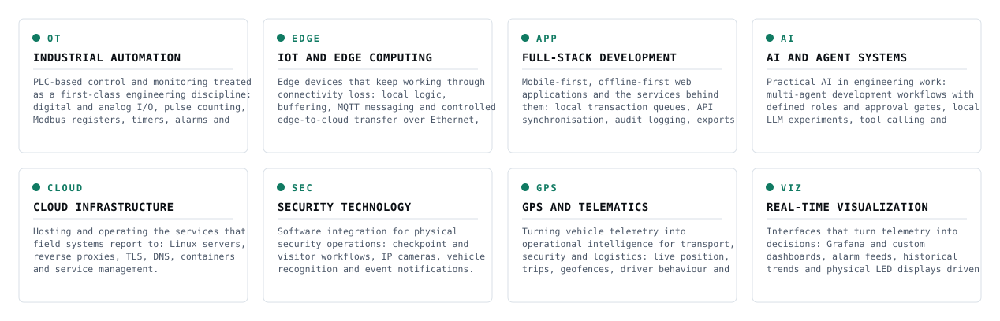
</picture>

## ▍Capability matrix

Technologies are tagged by evidence, not skill level: **project** (used in a listed project below), **explored** (evaluated or experimented with) or **portfolio** (adopted to build this profile/site). No familiarity ratings are shown.

<picture>
  <source media="(prefers-color-scheme: dark)" srcset="assets/matrix-dark.svg">
  
</picture>

## ▍Featured projects

Every project below carries a status recorded by the owner. Case studies describe my engineering contribution to each system — they are not a claim of ownership of any employer's or client's product, and no client is named.

<a href="case-studies/fuel-management.md"><picture><source media="(prefers-color-scheme: dark)" srcset="assets/cards/fuel-management-dark.svg">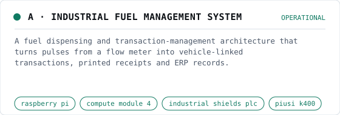</picture></a>
<a href="case-studies/security-checkpoint.md"><picture><source media="(prefers-color-scheme: dark)" srcset="assets/cards/security-checkpoint-dark.svg">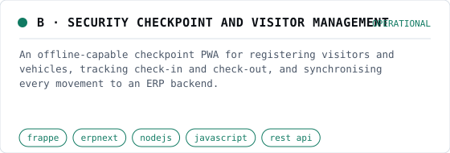</picture></a>

<a href="case-studies/industrial-monitoring.md"><picture><source media="(prefers-color-scheme: dark)" srcset="assets/cards/industrial-monitoring-dark.svg">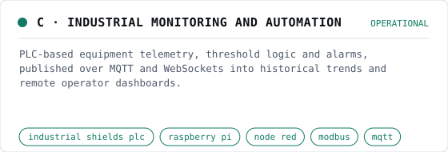</picture></a>
<a href="case-studies/fleet-intelligence.md"><picture><source media="(prefers-color-scheme: dark)" srcset="assets/cards/fleet-intelligence-dark.svg">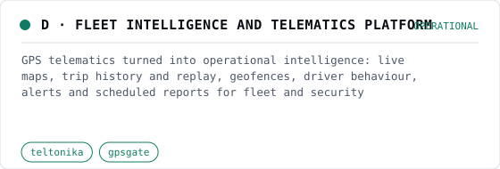</picture></a>

<a href="case-studies/led-matrix-control.md"><picture><source media="(prefers-color-scheme: dark)" srcset="assets/cards/led-matrix-control-dark.svg">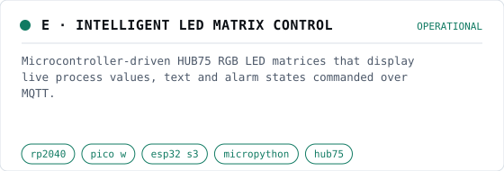</picture></a>
<a href="case-studies/ai-agent-lab.md"><picture><source media="(prefers-color-scheme: dark)" srcset="assets/cards/ai-agent-lab-dark.svg"></picture></a>

<a href="case-studies/erp-solutions.md"><picture><source media="(prefers-color-scheme: dark)" srcset="assets/cards/erp-solutions-dark.svg"></picture></a>
<a href="case-studies/monitoring-dashboards.md"><picture><source media="(prefers-color-scheme: dark)" srcset="assets/cards/monitoring-dashboards-dark.svg">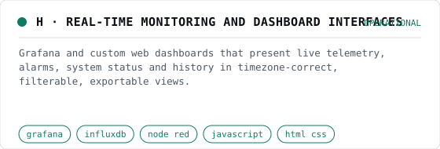</picture></a>

## ▍Edge-to-cloud pipeline

The recurring architecture behind most of the work above: local logic at the edge so the site keeps working when the uplink does not, then a controlled hand-off to the cloud.

<picture>
  <source media="(prefers-color-scheme: dark)" srcset="assets/pipeline-dark.svg">
  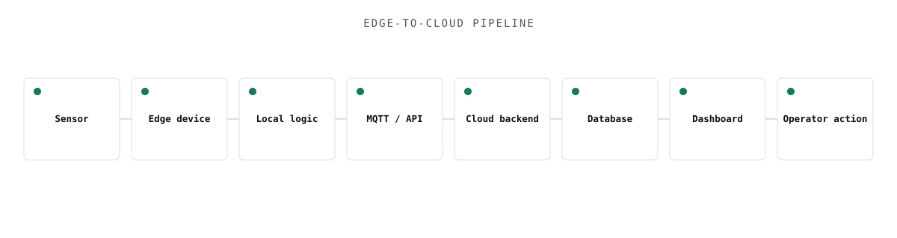
</picture>

## ▍AI engineering

AI models listed here were used or evaluated, not developed or trained by me. Agent workflows are described as they actually run, not as autonomous production systems — see the [AI agent lab case study](case-studies/ai-agent-lab.md).

<picture>
  <source media="(prefers-color-scheme: dark)" srcset="assets/ai-lab-dark.svg">
  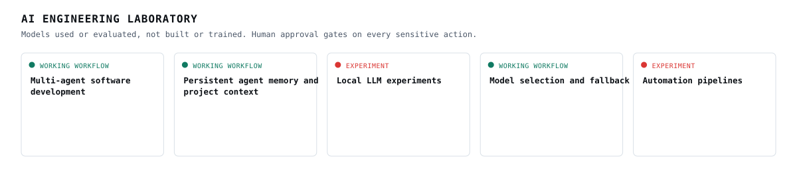
</picture>

## ▍Telemetry

<picture>
  <source media="(prefers-color-scheme: dark)" srcset="https://raw.githubusercontent.com/EnZo1826/EnZo1826/output/github-snake-dark.svg">
  
</picture>

<!--
metrics.svg is committed to the repo root daily by .github/workflows/metrics.yml.
The snake SVGs are pushed daily to branch `output` by .github/workflows/snake.yml.
-->

  Open to projects in Southern Africa and remote ·
  <a href="https://www.linkedin.com/in/jaco-hanekom-80821282/">LinkedIn</a>

