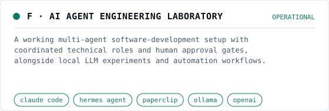

# F · AI agent engineering laboratory

<picture>
  <source media="(prefers-color-scheme: dark)" srcset="img/ai-agent-lab-dark.svg">
  
</picture>

**Status:** Operational (Owner-verified, 17 Oct 2026)

## Challenge

AI assistance is useful in engineering only when it is structured: clear roles, persistent context, reviewable output, and hard limits on what an agent may change without a human.

## My contribution

Design and operation of the agent roles, instructions, delegation workflow and approval rules; integration of the tools. The models themselves are third-party.

## Approach

- Specialised agents for frontend, backend, IoT, DevOps, security review and coordination, each with a written role definition (AGENTS.md-style instructions).
- Work is delegated as tracked tasks with plans, reviews and explicit human approval before anything is merged, deployed or touches a device.
- Persistent agent memory and project context carry decisions between sessions.
- Local models run through Ollama for experiments, tool calling and model comparison; hosted models are selected per task with fallbacks.
- n8n and scripted workflows are used for information collection, documentation and scheduled monitoring.

## Architecture

- **Engineer (approver)** (operator) — Sets objectives and approves sensitive actions.
- **Coordinator agents** (ai) — Plan, delegate and review.
- **Specialist agents** (ai) — Frontend, backend, IoT, DevOps, security.
- **Tools and repos** (backend) — Feature branches, pull requests, checks.
- **Hosted and local models** (ai) — Selected per task; local via Ollama.
- **Review and approval gate** (operator) — Nothing reaches production without a human.

## Capabilities

- Multi-agent software development
- Coordinated technical roles
- AI-assisted architecture
- Workflow orchestration
- Local AI experimentation
- Tool calling
- Developer productivity
- Agent configuration
- Persistent operational context

## Technologies

claude code, hermes agent, paperclip, ollama, openai, n8n, python, nodejs

