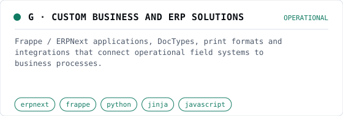

# G · Custom business and ERP solutions

<picture>
  <source media="(prefers-color-scheme: dark)" srcset="img/erp-solutions-dark.svg">
  
</picture>

**Status:** Operational (Owner-verified, 17 Oct 2026)

## Challenge

Field systems produce transactions; the business runs on quotations, invoices, assets and records. The two have to meet in one system without fighting the ERP framework.

## My contribution

Custom app development, print-format design, integrations and site deployment on Frappe / ERPNext.

## Approach

- Custom Frappe apps and DocTypes model operational records the standard ERP does not cover.
- Jinja print formats produce branded quotations, invoices and operational documents.
- REST APIs and web forms receive data from external PWAs and edge systems, with server-side business rules.
- Payroll and Namibian tax-related configuration are handled inside ERPNext rather than in side spreadsheets.
- Self-hosted ERPNext on Linux behind nginx with HTTPS.

## Architecture

- **Field PWAs and edge systems** (app) — Submit operational transactions.
- **Frappe REST API** (transport) — Authenticated integration endpoint.
- **Custom Frappe apps** (backend) — DocTypes, business rules, automation.
- **MariaDB** (data) — ERP and operational records.
- **Jinja print formats** (app) — Quotations, invoices, reports.
- **Business users** (operator) — Billing, payroll, asset and record management.

## Capabilities

- Custom business applications
- Operational record management
- API integration
- Invoice and quotation formatting
- Web forms
- Print formats
- Custom DocTypes
- Site deployment
- Application development
- Remote data synchronisation

## Technologies

erpnext, frappe, python, jinja, javascript, mariadb, nginx

