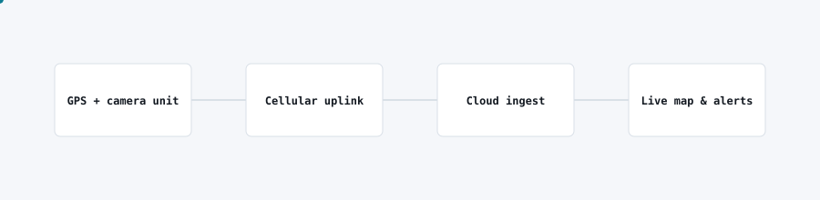

# Fleet telematics platform

<picture>
  <source media="(prefers-color-scheme: dark)" srcset="img/fleet-telematics-dark.svg">
  
</picture>

## Problem

Operators running vehicle fleets had no live visibility: no shared map, no speeding or geofence alerts, and video evidence sat on SD cards until someone physically collected it.

## What I built

A fleet telematics platform combining GPS and dashcam units with a live operations map, automated alerting, and on-demand video retrieval, so dispatch can see every vehicle and react to incidents in near real time.

## Architecture

- In-vehicle unit reports GPS position and triggers over a cellular uplink.
- Cloud ingest service normalises positions and events and stores them in a geo-indexed database.
- A live map renders fleet position and replays trips; rules-based alerts fire on speeding, geofence breaches and idle time.
- Video clips are pulled from the unit on demand rather than streamed continuously, to control bandwidth cost.

## Stack

React, TypeScript, Supabase/Postgres with PostGIS, offline-first PWA shell for field use.

## Outcome

Dispatch gained a live, shared view of the fleet and automated alerting replaced manual radio check-ins, cutting response time to incidents.
