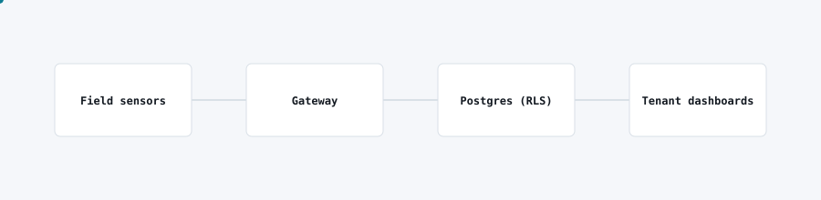

# Multi-tenant IoT analytics

<picture>
  <source media="(prefers-color-scheme: dark)" srcset="img/iot-analytics-dark.svg">
  
</picture>

## Problem

Several independent sites needed their own dashboards, forms and alarm rules over sensor data, but a separate deployment per site would not scale for a small team to operate.

## What I built

A single multi-tenant analytics platform: one codebase and database serving isolated dashboards, data-entry forms and alarm configuration per tenant, with strict row-level isolation.

## Architecture

- Field sensors and gateways push readings into a shared ingestion pipeline.
- Postgres with row-level security enforces tenant isolation at the data layer, not just in the application.
- Per-tenant dashboards, forms and alarm thresholds are configured without code changes.
- Alarms evaluate incoming readings against tenant-specific rules and notify the right people.

## Stack

React, TypeScript, Supabase/Postgres (RLS), scheduled alarm evaluation.

## Outcome

One platform now serves multiple independent tenants with strict data isolation, cutting operating cost per site compared to separate deployments.
