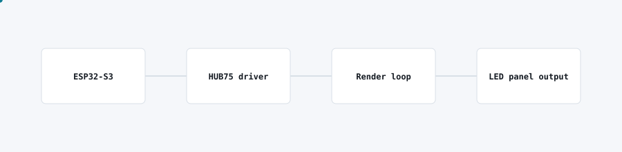

# ESP32-S3 LED display firmware

<picture>
  <source media="(prefers-color-scheme: dark)" srcset="img/led-display-firmware-dark.svg">
  
</picture>

## Problem

Large-format LED panel signage needed custom firmware: off-the-shelf controllers did not support the content and update workflow the fleet required.

## What I built

Firmware for ESP32-S3 boards driving HUB75 LED panels, with a render loop built for the content types the signage needed and a path for remote updates.

## Architecture

- The ESP32-S3 drives HUB75 panels directly through a dedicated driver.
- A render loop composes frames for the content types in use and pushes them to the panel at a stable frame rate.
- The firmware supports remote updates so panel behaviour can change without re-flashing on site.

## Stack

ESP32-S3, C++, HUB75 panel protocol.

## Outcome

The signage fleet runs on firmware purpose-built for its content and panels, instead of being constrained by a generic off-the-shelf controller.
