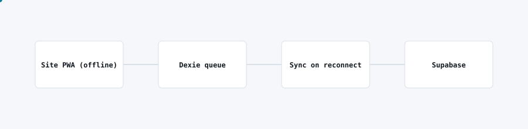

# Quarry operations platform

<picture>
  <source media="(prefers-color-scheme: dark)" srcset="img/quarry-operations-dark.svg">
  
</picture>

## Problem

Site staff at a remote operation needed to log production, equipment and safety data on tablets, but connectivity on site is intermittent, and roles range from operator to supervisor to admin.

## What I built

An offline-first operations app that works fully without a connection, queues changes locally, and syncs automatically when connectivity returns, with role-based access so each user sees only what their role needs.

## Architecture

- The PWA runs and captures data entirely offline, backed by a local browser database.
- Changes queue locally and sync to the cloud database once a connection is available, with conflict handling on sync.
- Role-based access control gates screens and actions by user role.
- The same app installs on tablets and desktops with no native build step.

## Stack

React, TypeScript, Vite, Dexie (IndexedDB) for the offline queue, Supabase/Postgres for the backend.

## Outcome

Staff keep working through connectivity gaps with no data loss, and supervisors get a role-appropriate view instead of one undifferentiated interface.
