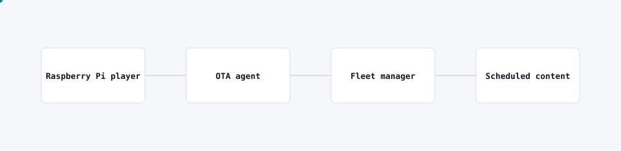

# Digital signage fleet

<picture>
  <source media="(prefers-color-scheme: dark)" srcset="img/signage-fleet-dark.svg">
  
</picture>

## Problem

A fleet of signage displays across multiple sites needed content pushed and updated without a technician visiting each screen.

## What I built

A fleet of Raspberry Pi signage players with an over-the-air agent, managed centrally, so content and software updates roll out to every screen remotely.

## Architecture

- Each Raspberry Pi runs a lightweight player with an OTA agent that checks in for updates and content.
- A fleet manager schedules content per device or group and tracks device health.
- Software updates to the player itself ship through the same OTA path, no physical access needed.

## Stack

Raspberry Pi, Node-RED for device-side orchestration, an OTA update mechanism, cloud fleet manager.

## Outcome

Content changes and software updates reach the whole fleet remotely, removing site visits that previously cost a technician's time per screen.
