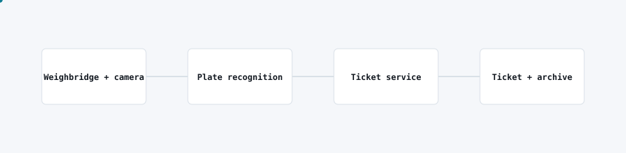

# Unattended weighbridge

<picture>
  <source media="(prefers-color-scheme: dark)" srcset="img/unattended-weighbridge-dark.svg">
  
</picture>

## Problem

A weighbridge required an attendant on every shift just to read a plate, record a weight and issue a paper ticket, which limited throughput and left a weak paper trail.

## What I built

An unattended weighbridge system that reads vehicle plates automatically, captures the weight reading, and issues a digital ticket without an operator present.

## Architecture

- A camera captures the vehicle at the weighbridge; automatic plate recognition extracts the registration.
- The ticket service correlates the plate with the weight reading from the bridge and generates a ticket.
- Every transaction is archived with its plate read, weight and timestamp for audit.

## Stack

Raspberry Pi edge device, Python for capture and recognition, cloud ticket service and archive.

## Outcome

The site runs the weighbridge unattended across shifts, with a consistent digital record replacing manual, paper-based tickets.
